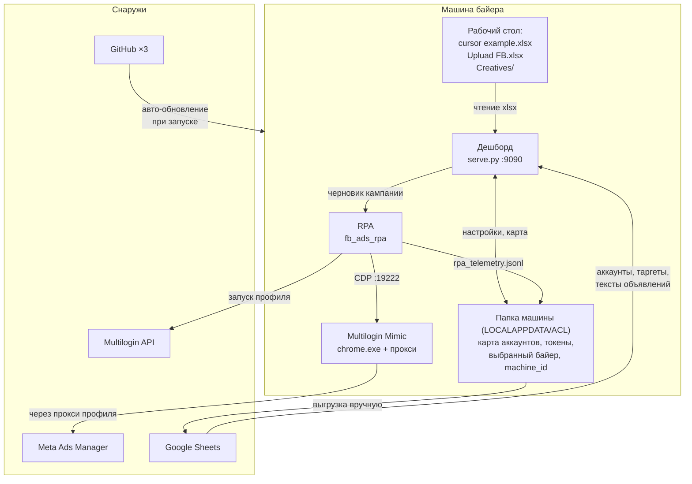

# ACL — карта интеграций

Что с чем связано, чем аутентифицируется, где настраивается и как ломается.

Составлено 2026-08-30 по факту кода, не по замыслу. Всё, что ниже, проверено
чтением исходников и запуском; места, где я не уверен, помечены явно.

---

## 1. Границы: что такое ACL, а что просто лежит рядом

Репозиторий больше, чем продукт. **ACL (Adopy Campaign Manager)** — это две
половины и общая конфигурация:

| Половина | Код | Что делает |
|---|---|---|
| **Дешборд** | `src/web`, `src/analysis_agent`, `src/campaign_bridge`, `src/upload_agent`, `serve.py` | читает статистику, показывает отчёт, собирает кампании, запускает публикацию |
| **RPA** | `src/fb_ads_rpa`, `src/meta_campaign_agent` | водит Ads Manager через браузер Multilogin, создаёт ЧЕРНОВИКИ кампаний |
| **Общее** | `config/paths.py`, `%LOCALAPPDATA%\ACL` | где лежат файлы машины и настройки |

**Рядом в том же репозитории живёт то, что в ACL не входит** и байеру не нужно:
`src/content_machine` (генерация контента и публикация в Telegram),
`src/jira_agent` (задачи в Jira), `src/fb_publish_agent` (старый путь публикации
через Graph API).

Здесь я сначала ошибся дважды: `knowledge_agent` и `creative_agent` попали у
меня в этот список, а на деле оба — часть ACL. Первый импортируют семь модулей
дешборда, второй — сам дешборд. Поймал это обход импортов, а не глаза.

Полный манифест — `docs/DISTRIBUTION.md`, и он держится не обещанием, а
`tests/test_distribution_boundary.py`. Что осталось нерешённым (**F-19**):
байеру по-прежнему приезжает весь каталог целиком — разделять ли репозиторий
физически, решение не принято.

---

## 2. Общая картина



---

## 3. Внешние интеграции

### 3.1 Meta Ads Manager — главная, и единственная опасная

**Как:** никакого API. RPA открывает `https://adsmanager.facebook.com` **внутри
браузера Multilogin** и кликает по интерфейсу через Playwright.

**Почему так:** у аккаунтов нет доступа к Marketing API, а если бы и был — они
живут за прокси и антидетект-профилем, и заходить в них из другого браузера
означало бы показать Meta вторую личность того же пользователя.

**Стык:** `src/fb_ads_rpa/browser.py` подключается к уже запущенному
`chrome.exe` Multilogin по CDP (порт `19222`), `meta_dom.py` (~7400 строк)
знает DOM Ads Manager, `ads_manager_flow.py` ведёт сценарий.

**Что важно знать:**

* RPA **никогда не жмёт настоящую кнопку публикации** — создаются только
  черновики. Публикует человек.
* Клики идут через CDP `Input.dispatchMouseEvent`, то есть с
  `isTrusted: true` — обычный `element.click()` Meta видит как автоматизацию.
* Есть жёсткий запрет открывать аккаунт вне Multilogin
  (`FB_RPA_ALLOW_PLAIN_BROWSER`) и перезапускать профиль без прокси
  (`FB_RPA_ALLOW_UNPROXIED_RELAUNCH`). Оба выключены. Это не перестраховка:
  ветка перезапуска однажды теряла прокси, и аккаунт ходил с реального IP.
* **Мониторинг живых аккаунтов запрещён** (`FB_RPA_ALLOW_ACCOUNT_WATCH`).
  25.08 регулярный опрос Ads Manager предшествовал телефонному чекпойнту.
  Расход и лиды берутся из статистики, не из браузера.

**Ломается чаще всего:** Meta меняет интерфейс. 24.08 один редизайн сломал
четыре шага сразу и стоил дня разбора. Это же и главный довод за телеметрию
(§3.4): один шаг, упавший в один день на всех машинах, — это редизайн, а не
местная поломка.

### 3.2 Multilogin — браузер и личность аккаунта

Три разных канала, и это стоит различать:

| Канал | Что даёт | Где |
|---|---|---|
| **Launcher API** `https://launcher.mlx.yt:45001/api/v2` | запуск профиля, порт отладки | `meta_campaign_agent/multilogin_launcher.py` |
| **Cloud API** `https://api.multilogin.com` | папки рабочего пространства | `src/web/app.py` |
| **Локальные файлы** `~/mlx/profiles/` | какие профили есть и какие открыты | `fb_ads_rpa/mlx_profiles.py` |

**Аутентификация:** `MULTILOGIN_AUTOMATION_TOKEN_A` — JWT, срок жизни
проверяется локально по полю `exp`, без сетевого запроса.

**Неочевидное, стоившее времени:**

* Процесс Multilogin называется `chrome.exe` — отличить его от обычного Chrome
  можно только по `--user-data-dir` внутри `mlx`.
* Windows пишет в командную строку короткие имена (`359D3E~1`), полный UUID
  восстанавливается по префиксу среди папок на диске.
* **Имена профилей API не отдаёт** (launcher — 404, cloud — 403 с нашим
  токеном). Единственный источник человеческого имени — заголовок окна браузера,
  читается через `ctypes`/`EnumWindows`.
* Какой кабинет у профиля — берётся из его собственной истории Chrome
  (`History`, SQLite): в каждом URL Ads Manager есть `act=<id>`. Файл
  копируется и читается локально, браузер при этом не трогается.

### 3.3 Google Sheets — чтение

Дешборд читает из таблиц только статус аккаунтов — через **пользовательский
OAuth**, не сервисный аккаунт (политика Workspace Adopy сервисные аккаунты запрещает).

| Что | Переменная | Модуль |
|---|---|---|
| Статус аккаунтов | `GSHEET_ACCOUNTS_ID` / `GSHEET_ACCOUNTS_SHEET` | `analysis_agent/gsheet_accounts.py` |

Таргеты и тексты объявлений из таблиц больше не читаются (ACL-1241): они живут
в общей библиотеке — приватном репозитории GitHub, см. раздел ниже.

### Общая библиотека таргетов и текстов (ACL-1241)

| Что | Где |
|---|---|
| Данные | приватный репозиторий `ACL_LIBRARY_REPO`: `targets.json`, `ad_texts.json` |
| Доступ | `ACL_LIBRARY_TOKEN` — fine-grained, только этот репозиторий, Contents: Read and write |
| Код | `analysis_agent/team_library.py`, реестры `targeting_registry.py` и `ad_text_registry.py` |
| Копия для чтения | `%LOCALAPPDATA%\ACL\targeting_registry.json`, `ad_text_registry.json` |
| Первое наполнение | `python scripts/seed_team_library.py` (`--dry-run`, `--add-missing`) |

Правка (Add, Edit, Remove, Restore) читает свежий файл, применяет изменение и
пишет его с sha прочитанной версии; если файл за это время поменял другой
менеджер, правка повторяется на новой версии вместе с проверкой повторов. Ошибка до отправки записи сообщает «Nothing was saved». Если ответ на запись
потерян, приложение один раз перечитывает файл: подтверждённое сохранение считается
успешным; неподтверждённое требует Refresh перед повтором. Ошибка локальной копии
после подтверждения GitHub не отменяет общую запись. Удалённое лежит в `deleted`
с автором и временем — это «Recently deleted» с кнопкой Restore.

До подключения дашбордов создайте приватный репозиторий и нужную ветку, выдайте
токен только для этого репозитория и запустите seeding с машины с исходной
библиотекой, сначала `--dry-run`, затем без него. Отсутствующий удалённый файл
не считается пустой библиотекой и не заменяет локальные данные; создать файлы
может только seeding. Обычный seeding сохраняет существующую историю удалений.
`--add-missing` предназначен для явного добавления недостающих записей.

Перед первой заменой локального реестра сохраняется неизменяемая копия
`targeting_registry.pre-team-library.json` / `ad_text_registry.pre-team-library.json`
в том же каталоге. Сохраните её при миграции: она содержит локальные записи,
которых могло не быть в общей библиотеке. Не загружайте резервную копию целиком
поверх существующей общей версии. Повреждённые записи в GitHub блокируют всё
обновление копии, а не исчезают из списка по одной.

Подключение — это токен (ACL-2038): репозиторий и ветка по умолчанию —
`MojoTheApe/acl-lib` и `main`, `ACL_LIBRARY_REPO` / `ACL_LIBRARY_BRANCH` в
настройках машины главнее. Токен вводится один раз в дешборде («Connect team
library»). Без токена — локальный режим, и интерфейс явно сообщает его область. Билдер обновляет библиотеку
при открытии; подготовка публикации — ещё раз перед обработкой объявлений.
При потере связи используется сохранённая копия с предупреждением и временем
её последней синхронизации (время сохраняется между запусками). Неизвестный
таргет в настроенной общей библиотеке останавливает подготовку, а не превращает
кампанию в широкую аудиторию.

OAuth-клиент: `%LOCALAPPDATA%\ACL\oauth_client.json`. Токен чтения:
`%LOCALAPPDATA%\ACL\token_accounts.json`, права **только на чтение**.

Лист аккаунтов берётся с **самой правой вкладки** — они именуются по дате
(`27.08`), и правая всегда свежая.

### 3.4 Google Sheets — запись (телеметрия)

**Отдельный токен с правом записи**: `%LOCALAPPDATA%\ACL\token_telemetry.json`.
Разделение намеренное — расширение прав здесь не может стоить дешборду его
доступа на чтение.

Как ходит телеметрия:

1. Каждый прогон дописывает строку в `output/rpa_telemetry.jsonl` — локально,
   **без единого сетевого запроса**. Прогон публикации не должен зависеть от
   сети.
2. Выгрузка — **отдельная команда**: `python scripts/acl_telemetry_upload.py`.
3. Курсор (`telemetry_cursor.json`) сдвигается только после подтверждённой
   записи, поэтому обрыв связи не теряет и не задваивает строки.
4. Отчёт по собранному: `scripts/acl_telemetry_report.py`, умеет писать в
   Obsidian (`ACL_OBSIDIAN_DIR`).

В каждой строке — версия потока вида `v96+9@28600e9` (см. §5), то есть отчёты
разных машин сравнимы.

Реализованы ещё два транспорта (webhook Apps Script и сервисный аккаунт) — оба
закрыты политикой организации, код оставлен на случай, если политику изменят.

### 3.5 Файлы на диске

| Что | Переменная | Умолчание |
|---|---|---|
| Статистика | `FB_STATS_EXCEL` | `~/Desktop/cursor example.xlsx` |
| Загрузка кампаний | `UPLOAD_FB_EXCEL` | `~/Desktop/Upluad FB.xlsx` |
| Креативы | `FB_CREATIVES_ROOT` | `~/Desktop/Creatives` |

Умолчания строятся от **рабочего стола текущего пользователя**, а не от
конкретного имени: на чужой машине путь ведёт к её собственному столу, а не к
несуществующей папке постороннего человека.

Отчёт кэшируется по паре «путь + время изменения файла» и по выбранному
кампейн-менеджеру. Первая сборка из ~71 тыс. строк — около полутора минут,
дальше отдаётся за секунды.

### 3.6 GitHub — три адреса и авто-обновление

Один `git push` уходит в три места:

* `JenyaFarber/fb_agents`
* `evgenis-ctrl/fb_agents`
* `MojoTheApe/adopy-campaing-launcher` — рабочий, его читают разработчики

**Это настройка клона, в гит она не попадает.** После `git clone` её надо
задавать заново (команды — в `CLAUDE.md`). Проверка, что все три на месте:
`git push --dry-run -v` должен напечатать три строки `Pushing to`.

**Авто-обновление** (`start_dashboard.bat`) включается только на машинах,
помеченных установщиком, — чекаут разработчика никогда не обновляется сам.
Порядок с 30.08 такой: `fetch` (код скачан, но НЕ активирован) → установка
зависимостей новой версии → только при успехе `merge` → проверка запуска
(`scripts/acl_smoke.py`) → при провале откат. Не встало — байер продолжает
работать на вчерашней версии.

### 3.7 Интеграции вне ACL

Работают, но к запуску кампаний отношения не имеют:

| Что | Куда ходит | Ключ |
|---|---|---|
| Jira | `mar-adopy.atlassian.net` | `JIRA_EMAIL`, `JIRA_API_TOKEN` |
| Anthropic | `api.anthropic.com` | `ANTHROPIC_API_KEY` |
| OpenAI | `api.openai.com` | `OPENAI_API_KEY` |
| Google AI | `generativelanguage.googleapis.com` | `GOOGLE_API_KEY` |
| Telegram | Bot API | `TG_BOT_TOKEN` |
| Meta Graph API | `graph.facebook.com` | `META_ACCESS_TOKEN` |
| Новости | `news.google.com`, `api.gdeltproject.org` | — |

Это и есть то, о чём **F-19**: раздавая ACL, мы раздаём и их.

---

## 4. Внутренние стыки

**Путь от статистики до черновика кампании:**

```
cursor example.xlsx
   → analysis_agent/analyze_fb_stats.py   разбор имён кампаний и адсетов
   → analysis_agent/morning_report.py     сборка отчёта по странам
   → web/app.py                           показ + конструктор кампаний
   → campaign_bridge/assembly.py          слоты формы → черновик
   → fb_ads_rpa/build_draft.py            + enrich_draft.py (карта аккаунтов)
   → fb_ads_rpa/ads_manager_flow.py       вождение Ads Manager
   → черновик в Ads Manager (публикует человек)
```

**Два стыка, где чаще всего ломается смысл:**

1. **Имена аккаунтов.** В статистике аккаунт называется `FacebookUL921 CR Ait`,
   в Multilogin — `KLD_BFL_W27`, в карте — третьим образом. Сводятся они
   `normalize_account_alias()` (первый токен — это личность) и
   `profile_name_key()` (буква+цифры в хвосте имени профиля).
2. **Классификация отказов.** Единственная таблица —
   `fb_ads_rpa/failure_policy.py`. Она решает, что делает черновик
   непубликуемым: отсутствие медиа, битое назначение, не выставленная страна,
   не выбранное событие конверсии. Неизвестное имя шага считается блокирующим:
   ложная блокировка стоит взгляда на черновик, пропущенная — живого спенда.

---

## 5. Где что настраивается

**Правило:** код живёт в гите, настройки машины — на машине. Иначе обновление
переписало бы карту аккаунтов десяти байеров одной чужой.

`%LOCALAPPDATA%\ACL` (перекрывается `ACL_CONFIG_DIR`):

| Файл | Что |
|---|---|
| `ad_account_map.csv` | аккаунт → кабинет, профиль, папка, страна |
| `token_telemetry.json` | токен записи в Sheets |
| `selected_cm.txt` | выбранный кампейн-менеджер |
| `machine_id.txt` | идентификатор машины для телеметрии |
| `telemetry_cursor.json` | сколько строк уже выгружено |
| `auto_update` | метка «эта машина обновляется сама» |
| `.env` | настройки; читается **первым** и побеждает чекаутный |

Проверить состояние машины: `python scripts/acl_doctor.py` — печатает, какой
`.env` подхвачен, где карта, жив ли токен Multilogin, на месте ли файлы.

**Версия того, что реально работает** — `telemetry_sync.flow_version()`,
печатается при старте дешборда:

```
v96+9@28600e9
 │   │  └─ фактический коммит
 │   └──── коммитов по коду RPA с последней подтверждённой точки
 └──────── задуманная версия потока (правится руками)
```

Хвостовая `*` означает локальные правки кода, то есть машину разработчика.

---

## 6. Что помнить при поломках

| Симптом | Смотреть в первую очередь |
|---|---|
| Дешборд не стартует, `ModuleNotFoundError` | какой Python первым в PATH; ACL предпочитает свой `.venv` |
| Шаг RPA падает у всех разом | редизайн Meta, а не местная поломка — сверить телеметрию по датам |
| Шаги стали в 10–50 раз медленнее | окно браузера свёрнуто (throttling), лечится в `browser.py` |
| Прогоны стали хуже после 15–20 подряд | усталость тестового аккаунта, а не регрессия кода |
| Аккаунт получил чекпойнт | проверить, был ли `--proxy-server` в командной строке `chrome.exe` |
| Страна/аккаунт не сходятся в отчёте | суффиксы в алиасе — см. `normalize_account_alias` |

---

## 7. Известные дыры (по состоянию на 30.08)

* **Сборка ни разу не наблюдалась.** Workflow есть, но репозитории закрытые, и
  результат прогона никто не видел.
* **Каналов версий нет** (F-13, половина). Стабильная точка —
  `master` + тег `acl-release-2026-08-30`. Канареечной выкатки и автоотката нет.
* **Идентификаторы кабинетов и профилей остались в истории гита** (F-18).
  Сам файл `config/ad_account_map.csv` из-под гита выведен ещё 25.08
  (коммит `614e630`) и закрыт в `.gitignore` — в рабочем дереве его нет. Но он
  присутствует в 12 старых коммитах, и переписывание общей истории — отдельное
  решение, которое надо согласовать. Текущее дерево и все будущие коммиты
  проверяются `scripts/acl_scan_secrets.py`.
* **`.env` у большинства установок только в чекауте.** Работает, но папка
  чекаута — та, которую переписывает обновление. Доктор об этом предупреждает.
* **Границы дистрибутива не проведены** (F-19): байеру уезжает весь
  репозиторий, включая Jira, LLM-ключи и контент-машину.
