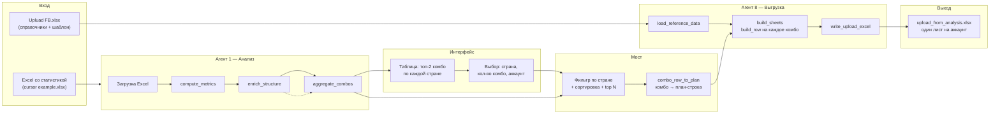

# Схема и интерфейс: Агент 1 + Агент 8

## Архитектура и поток данных



- **Агент 1** читает Excel со статистикой, считает метрики, строит комбо (Strong/Interesting) по странам.
- **Интерфейс** показывает таблицу и запрашивает у пользователя страну, число комбо и аккаунт.
- **Мост** (`run_analysis_then_upload.py`) фильтрует комбо по стране, берёт топ N, превращает каждое комбо в план-строку (`combo_row_to_plan`: Country Final, Offer, Device, Interest, Age, Creative, TopAdTitle → account, country, asset, os, creative, targeting, age, creative_number, date, copy).
- **Агент 8** поднимает справочники из Upluad FB.xlsx (Accounts, Ad copy, Countries, Interests, Video/Image file name), по плану заполняет строки шаблона (build_row) и пишет один .xlsx с листом на аккаунт.

---

## Как выглядит интерфейс (пошагово)

Единственная точка входа для связки «анализ → выгрузка» — `run_upload_interactive.py`.

| Шаг | Что видит пользователь | Действие |
|-----|------------------------|----------|
| 1 | Заголовок «Выгрузка кампаний из анализа», запрос пути к файлу со статистикой | Ввести путь или Enter (подставится путь из конфига) |
| 2 | Таблица: топ-2 связки по каждой стране (Country, Offer, Targeting+Creative, Type, Dep, ROI) | Просмотр, решение по какой стране и сколько комбо брать |
| 3 | Список стран из колонки Country с количеством комбо по каждой | Ввести номер страны или её название |
| 4 | Подтверждение «Выбрано: &lt;страна&gt;» | — |
| 5 | Запрос «Сколько комбо взять» | Число или Enter (по умолчанию 2) |
| 6 | Запрос «Имя аккаунта для листа в выгрузке» | Ввести аккаунт (например FacebookUL574 GT BID) — пользователь сам выбирает, на какой аккаунт поднимать кампанию |
| 7 | «Выгружаю...» | Ожидание |
| 8 | «Готово. Файл: output/upload_from_analysis.xlsx» | Открыть файл: один лист с именем аккаунта, строки — кампании по выбранным комбо |

Итог: пользователь сам выбирает страну, количество комбо и **аккаунт**; скрипт не подставляет аккаунт по умолчанию.

---

## Альтернатива: запуск без диалога (CLI)

Для скриптовой/автоматической выгрузки используется `run_analysis_then_upload.py`:

```bash
python run_analysis_then_upload.py -e "путь/к/статистике.xlsx" -a "FacebookUL574 GT BID" -c Mexico -t 2 -o output/upload_from_analysis.xlsx
```

Параметры: `--excel`, `--account`, `--country`, `--top`, `--output`, `--upload-excel` (опционально), `--plan-csv` (опционально сохранить план). Интерфейс в этом режиме — только аргументы командной строки, без интерактивных вопросов.

---

## Файлы и роли

| Файл | Роль |
|------|------|
| `run_upload_interactive.py` | Единая точка входа: загрузка, отчёт агента 1, диалог (страна / кол-во комбо / аккаунт), вызов моста |
| `run_analysis_then_upload.py` | Мост: пайплайн агента 1 → фильтр/топ N → combo_row_to_plan → вызов Agent 8 |
| `src/analysis_agent/analyze_fb_stats.py` | Агент 1: метрики, обогащение, комбо, print_short_report |
| `src/upload_agent/build_upload_excel.py` | Агент 8: справочники, build_row, запись Excel |
| `config/paths.py` | Пути по умолчанию к Excel со статистикой и к Upluad FB.xlsx |
