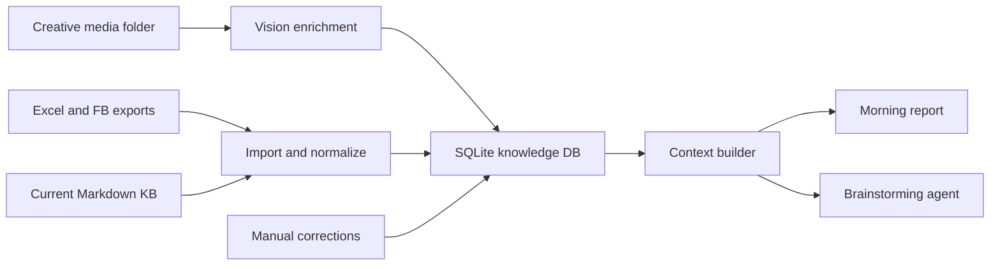
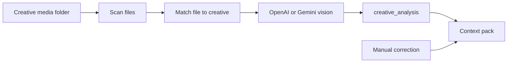

# Knowledge Base Context Pack System — Design Spec

**Date:** 2026-05-01
**Status:** Draft for review
**Owner:** Evgeni Sedin

---

## Goal

Turn the current `knowledge_base` folder into a structured knowledge system that helps the analysis agent and brainstorming workflow understand:

- what is shown in each creative;
- what audience each target/interest represents;
- what ad text says and which angle it uses;
- where each offer + target + creative + text combination worked or failed;
- what information is missing and needs manual input.

The main output of the system is a **context pack**: a compact Markdown block that the agent can use in morning reports, creative analysis, and brainstorming new materials.

---

## Current Context

The project already has:

- `knowledge_base/offers.md`: offer reference, aliases, LP URLs, audience, USP, country notes.
- `knowledge_base/targets.md`: target/interest codes, FB interests, audience descriptions, aliases, notes.
- `knowledge_base/creatives.md`: generated creative inventory from Excel with ad titles, inferred type, offer, deposits.
- `knowledge_base/landing_pages.md`: parsed LP status, titles, meta descriptions, CTA.
- `knowledge_base/test_history.md`: human learnings about targets, offers, countries, devices, and age groups.
- `config/knowledge_base.json`: structured JSON used by `src/knowledge_agent/knowledge_base.py`.
- `src/analysis_agent/morning_report.py`: morning report builder with AI Context and Hypotheses sections.

The current morning report already reads target context, but it does not yet combine offer meaning, creative understanding, ad text, performance memory, and missing-field signals into one agent-ready object.

---

## Architecture

Use a hybrid architecture:

1. **Source layer**
   - Existing Markdown and JSON knowledge files.
   - Excel/Facebook exports.
   - A configured folder containing creative media files.
   - Manual notes and corrections.

2. **Structured DB layer**
   - A local SQLite database stores normalized entities and relationships.
   - SQLite is the working source for lookup, matching, joins, and context pack generation.

3. **Agent context layer**
   - A context builder reads SQLite and emits compact Markdown context packs.
   - Morning report and brainstorming use context packs instead of reading the entire knowledge base.



---

## Context Pack First

The database exists to produce context packs. A context pack must answer: "What should the agent know before analyzing or generating materials?"

### Combo Context Pack

Used for a specific performance row or combination:

```text
Country / Offer / Target / Creative / Ad Text

Offer meaning:
Target audience:
Creative understanding:
Ad text:
Performance memory:
Why it may work:
Risks:
Missing fields:
Suggested next angles:
```

Example:

```text
EC / Favorita / Trading / Video3509 The app / ES Benefit

Offer: Favorita = local Ecuador retail brand, trust-based investment angle.
Target: Trading = market/trading interest; historically works in EC.
Creative: mobile-app / investment-ui video; easy-start visual pattern.
Ad text: Spanish benefit angle; CTA to request information.
Performance memory: Favorita + Trading + EC is a known winning pattern; best campaigns reached very high ROI, but market is limited.
Recommendation logic: generate new materials around local trust + simple access, avoid aggressive scale and unrealistic profit promises.
Missing: full ad text body if not imported yet.
```

### Creative Context Pack

Used when analyzing or adapting one creative:

```text
Creative:
Known aliases:
Media files:
Auto vision summary:
Manual correction:
Used with texts:
Worked in:
Failed in:
Similar creatives:
Missing fields:
```

### Offer-Country Context Pack

Used for brainstorming new materials:

```text
Offer + Country:
Positioning:
Best targets:
Best creative patterns:
Best ad text angles:
Weak/failed patterns:
Compliance/risk notes:
Open gaps:
New material directions:
```

Context packs should be viewable as Markdown, both inside the morning report and as standalone files when needed.

---

## Data Model

### Core Reference

- `offers`
  - Canonical offer name, aliases, languages, top countries, audience, USP, notes.
- `targets`
  - Canonical target code, label, aliases, FB interests, audience, top countries, notes.
- `landing_pages`
  - Offer, URL, status, title, meta description, CTA, parsed language, notes.

### Creative Intelligence

- `creatives`
  - Canonical creative ID/name, aliases, inferred type, offer hints, aggregate deposit summary.
- `creative_assets`
  - Media file path, hash, file type, size, duration/metadata, linked creative ID.
- `creative_analysis`
  - Auto vision result: visual summary, on-screen text, language, hook, CTA, people/objects, emotion, claims, visual tags, confidence, provider, analyzed timestamp.
- `manual_overrides`
  - Human corrections that override auto analysis in context packs.

### Ad Copy

- `ad_texts`
  - Full ad text, language, hook/angle, CTA, offer, source, risk flags, status.
- `creative_text_links`
  - Links ad text to creative when a text was used with that creative.

### Performance Memory

- `performance_snapshots`
  - Country, account, offer, target, creative, text segment, spend, leads, deposits, CPA, ROI, date/period, source row metadata.
- `test_learnings`
  - Human learning: what worked, what failed, likely reason, confidence, tags.

### Agent Workflow

- `missing_fields`
  - Explicit records for missing or uncertain information, such as missing creative description, missing ad text body, unmatched media file, or low confidence vision output.
- `context_requests`
  - Optional log of context packs requested by agents for debugging and improvement.

---

## Creative Vision Enrichment

Vision enrichment is a separate step, not part of morning report generation. Morning report should read already-enriched data so it stays fast and reliable.

Pipeline:



The scanner:

- reads files from a configured creative media folder;
- calculates file hashes to avoid reprocessing duplicates;
- matches file names to creative aliases and ad titles;
- marks uncertain matches as `needs_review`.

The vision step:

- uses the existing project LLM configuration style, with OpenAI/Gemini provider settings from environment variables;
- analyzes images directly;
- analyzes videos through thumbnails/keyframes first, with direct video support left as a future provider-specific improvement;
- stores structured analysis in `creative_analysis`;
- records confidence and missing fields instead of blocking the workflow.

Manual overrides always win over auto analysis when building context packs.

---

## Manual Correction Workflow

Manual input is a first-class workflow, not an exception.

When an agent cannot see or infer something, it should surface it as missing:

```text
Missing:
- creative.visual_summary
- creative.on_screen_text
- ad_text.body
- creative_asset.file_path
```

The user can then add or correct fields manually. The context builder resolves values in this order:

1. Manual override.
2. Auto vision or imported structured data.
3. Existing Markdown/JSON reference.
4. Missing-field placeholder.

This lets the system improve incrementally without pretending the data is complete.

---

## Morning Report Integration

Current morning report behavior should remain intact while context packs are added gradually.

Initial integration points:

- Expand AI Context/Hypotheses sections to use `ContextBuilder`.
- Add combo context for top working combinations.
- Add creative understanding under top creatives where available.
- Add target audience explanations beyond the raw interest code.
- Add missing-field warnings in the report so the user can fill gaps.

Later integration:

- Use context packs to improve "open campaigns" recommendations.
- Avoid recommending patterns that `test_learnings` mark as weak or risky.
- Explain why a recommendation was made using offer + target + creative + text context, not only metrics.

---

## Brainstorming Integration

Before generating new materials, the brainstorming agent should request the relevant context pack.

Examples:

- "New materials for Favorita EC" -> `Offer-Country Context Pack`.
- "Why did Blue_6t work?" -> `Creative Context Pack`.
- "Analyze this running combo" -> `Combo Context Pack`.

The brainstorming flow should start by showing what the agent knows and what is missing. If critical fields are missing, the agent asks the user to provide them or continues with clearly stated uncertainty.

---

## Import and Sync Strategy

The implementation should preserve current generated Markdown workflows and add DB sync around them.

Planned importers:

- Markdown/JSON importer for existing offers, targets, landing pages, creatives, and test history.
- Excel/Facebook importer for performance snapshots and ad text segments.
- Creative media scanner for local creative files.
- Vision enrichment runner for unmatched or unanalyzed media files.
- Markdown exporter for context packs and human-readable knowledge snapshots.

The first implementation should avoid large rewrites of existing scripts. It should add new modules around the current `src/knowledge_agent/knowledge_base.py` API and the existing morning report builder.

---

## Error Handling and Review Signals

The system should prefer explicit uncertainty over silent guesses.

Important states:

- `missing`: required field is absent.
- `needs_review`: automatic match or analysis is uncertain.
- `vision_failed`: provider call failed or returned unusable output.
- `unmatched_asset`: media file exists but cannot be linked to a creative.
- `unmatched_creative`: ad title exists but no media file was found.

Context packs should include these states when relevant.

---

## Testing Strategy

Tests should focus on behavior that protects future analysis quality:

- DB import preserves offers, targets, creatives, aliases, and test learnings.
- Creative matching handles aliases and uncertain matches.
- Manual overrides take priority over auto analysis.
- Context packs include offer, target, creative, ad text, performance memory, risk notes, and missing fields.
- Morning report remains usable when the DB, vision data, or ad text is incomplete.
- Existing morning report tests continue passing.

---

## Phased Delivery

### Phase 1: Context Pack Foundation

- Create SQLite schema and access layer.
- Import existing knowledge base files and current JSON.
- Generate combo, creative, and offer-country context packs as Markdown.
- Add missing-field reporting.

### Phase 2: Morning Report Integration

- Wire context packs into morning report AI Context/Hypotheses.
- Add creative understanding and missing-field notes to report output.
- Keep existing morning report behavior as fallback.

### Phase 3: Creative Vision Enrichment

- Add media scanner.
- Add image/keyframe vision analysis through existing OpenAI/Gemini configuration.
- Store structured creative analysis.
- Support manual overrides.

### Phase 4: Brainstorming Workflow

- Make brainstorming agent load context packs before generating new materials.
- Use offer-country and creative packs to propose new angles.
- Surface missing data before making high-confidence recommendations.

---

## Open Decisions

These can be finalized during implementation planning:

- Exact SQLite file path.
- Exact creative media folder path.
- Whether ad text body comes first from Excel columns, separate files, or manual entry.
- Whether video analysis uses generated keyframes only or direct video model support when available.

---

## Approval Criteria

The design is ready for implementation planning when the user confirms:

- context pack is the main artifact;
- hybrid SQLite + Markdown approach is acceptable;
- manual corrections should override auto analysis;
- morning report and brainstorming should both consume context packs;
- auto vision analysis can use existing OpenAI/Gemini LLM settings.
